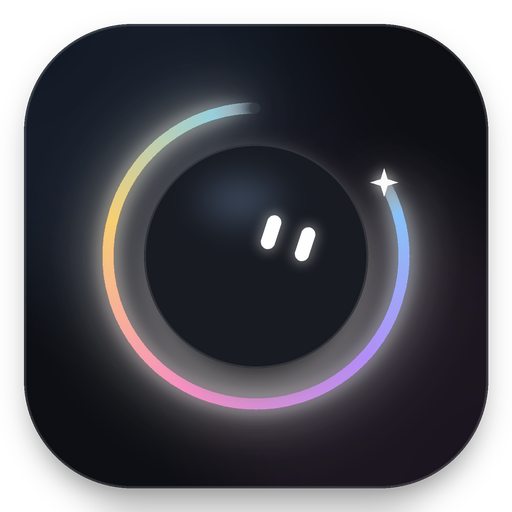
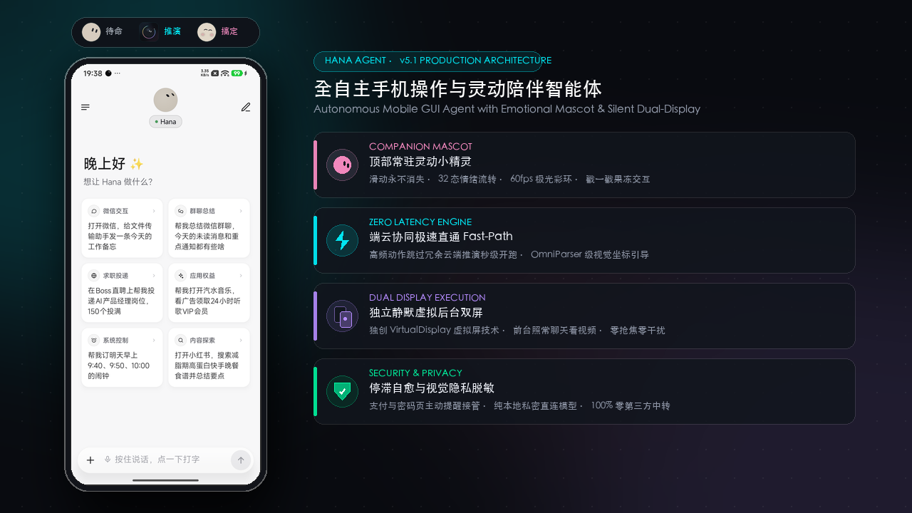

# Hana

**Autonomous Phone-Operating Agent with Mascot Presence**

Say what you need, and Hana automatically plans, perceives, operates apps, and browses the web until your task is done.  
Engineered with background virtual-display execution and an interactive companion mascot — it works silently in the background while you keep using your phone uninterrupted.

English · [简体中文](docs/readme/README.zh-CN.md) · [繁體中文](docs/readme/README.zh-Hant.md) · [日本語](docs/readme/README.ja.md) · [한국어](docs/readme/README.ko.md) · [Español](docs/readme/README.es.md)

 

Hana's refined Jetpack Compose UI featuring the persistent top mascot avatar, dynamic state pill, and zero-latency autonomous action engine

## Complex tasks completed in one sentence

Simply speak your request in natural language. Hana orchestrates end-to-end perception, intent-gating, and background phone actions across applications:

- 📱 **Social & Daily Automation**: "Open WeChat, send today's memo to File Transfer" · "Search RED for latest camping guides and like the top 3 posts"
- 🛒 **E-Commerce Price Comparison**: "Search shopping apps for fast chargers under $30 with 4.5+ stars, add the top pick to cart, stop before checkout"
- 🔍 **Chat & Content Synthesis**: "Read through today's chat history in my study group and summarize key takeaways"
- ⏰ **System & Routine Schedules**: "Set alarms for 8:30 and 9:00 tomorrow morning, and check if it will rain"

## Why Hana

| Feature | Description |
|---|---|
| 🤖 **Companion Mascot Presence** | Permanent top mascot pill that stays visible while scrolling; dynamic mood and animations (neon aurora ring, curious tilt, happy jump), jelly tactile squishy feedback, and 4 customizable geometric shapes. |
| ⚡ **Zero-Latency Fast-Path** | Eliminates sluggish cold starts: intent fast-gating skips redundant remote inference for immediate action, paired with OmniParser-grade coordinate grounding and action chaining. |
| 📱 **Silent Background Screen** | Opens apps, taps, types, and scrolls on a dedicated virtual background display without interfering with your current foreground phone usage. |
| 🛡️ **Self-Healing & Privacy Safe** | Built-in stagnation breakout and automated fault recovery; sensitive auth/payment screens proactively hand off to you with visual privacy sanitization. |
| 🧩 **Universal App Compatibility** | Interacts like a human through native accessibility and vision — no app APIs or per-app integrations required. |
| 🧠 **Hybrid Cloud & Local SLM** | Supports on-device small language models (Qwen, UI-TARS) alongside cloud LLMs for local burst execution and multi-tier routing. |
| 🔒 **Strict Local Privacy** | No central servers; your prompt context and screen frames go directly and only to your configured model provider. |
| 🆓 **Open Source & Free** | Apache-2.0 licensed, 100% transparent and open codebase. |

## Get started in three steps

1. **Install**: download the APK from [Releases](https://github.com/mengqingshi922-ctrl/hana/releases/latest).
2. **Connect a model**: in Settings › Model, pick a provider and enter an API key, or just sign in with an account ([models and sign-in](docs/models.en.md)).
3. **To operate phone apps**: follow the "Set up phone control" wizard in Settings and pair wireless debugging on the phone once ([setup guide](docs/setup-guide.en.md)). Skip this if you only want chat, web and files.

Then try saying: "Set alarms for 9:40 and 10:00 tomorrow morning" or "Check the weather at 8 every morning and tell me only if it will rain".

> 💡 Have a computer handy? Send this to the AI agent on it and it will set everything up for you: 
> `Follow https://github.com/mengqingshi922-ctrl/hana/blob/main/docs/install-with-agent.en.md to install Hana on the Android phone connected over USB.`

## What it can do

| | |
|---|---|
| **Operate apps** | Reads long lists and chat histories, taps and types, shares text into apps; hands logins, verification codes and payments to you |
| **Browse the web** | A built-in desktop-class browser that keeps you signed in, reads pages, downloads and uploads; paces itself and hands block pages to you |
| **Your current screen** | Double-tap the floating capsule to send the screen you're looking at: "how should I reply?", "note this down" |
| **Schedules and conditions** | "Remind me at 9 tomorrow", "do this every Friday"; runs on time in the original conversation |
| **Jump in or stop anytime** | Keep talking while a task runs to add or correct things (long-press to withdraw or edit one Hana hasn't picked up yet); after a stop it reports where it got to, and "continue" picks up from there |
| **Hold to talk** | Hold the chat input to speak and edit the words before sending; long-press the floating capsule to speak and release to send. Uses the phone’s built-in speech recognition, or a provider’s speech model if it has none |
| **Files and computing** | A Linux sandbox per conversation runs Python, Node and shell on the files you send (arm64) |
| **From your computer** | AI tools on your computer can hand Hana tasks through CLI + Skill or MCP ([use Hana from a computer](docs/computer.en.md)) |

By default Hana runs in **Ask mode**: it checks with you only before spending money (placing orders, paying) and just does everything else. You can switch to **Autonomous mode** instead. See [Ask and Autonomous](docs/modes.en.md).

For how each of these works and the finer details, see [features in detail](docs/features.en.md).

Apps and websites with built-in usage knowledge (anything not listed still works)

The names are shown as they appear in the knowledge files.

<!-- generated:knowledge:start -->
<!-- Generated by ./gradlew updateReadme; do not edit by hand -->
| Category | Built in |
|---|---|
| **Apps** | Android 设置, 百家号, 哔哩哔哩, BOSS直聘, Chrome, 得到, 抖音, 飞书, Gmail, 即刻, 快手, 领英, QQ邮箱, Telegram, 今日头条, Uber, Uber Eats, 微信, 微博, WhatsApp, 闲鱼, 小红书, 知乎 |
| **Websites** | Amazon, 哔哩哔哩, Google Calendar, 豆瓣, 抖音, Instagram, Gmail, Google Maps, Telegram, 百度贴吧, 微博, 搜狗微信, WhatsApp, 小红书, 小宇宙, YouTube, 知乎, BOSS直聘 |
| **How-to skills** | 改 Hana 自己的设置, 把内容整理成文字, 处理 PDF 文档, 查清一件事, 消息与邮件, 写技能 |
<!-- generated:knowledge:end -->

Supported model providers

<!-- generated:providers:start -->
<!-- Generated by ./gradlew updateReadme; do not edit by hand -->
Presets for DeepSeek, Agnes AI (中国站), Agnes AI (国际站), AMD (中国站), 通义千问, Kimi, 智谱, 硅基流动, 火山方舟, MiniMax, 阶跃星辰, 腾讯混元, 百度千帆, OpenRouter, OpenCode Go, Anthropic, Gemini, OpenAI, xAI, Mistral, Groq, Ollama, LM Studio, 本地端侧模型 (Local SLM) and more; for any other provider pick Custom (自定义), which takes any OpenAI-compatible, Anthropic, Gemini or OpenAI Responses endpoint.
<!-- generated:providers:end -->

You can also skip the key and sign in with a ChatGPT (Plus / Pro), xAI / Grok or OpenRouter account. Steps for adding a model, and what to know about each sign-in, are in [models and sign-in](docs/models.en.md).

## Which phones

| | Requirement |
|---|---|
| Chat, web, files | Android 11 or later |
| Operating phone apps | Android 12 or later; **Android 14+ recommended** (the background screen has its own focus, so it doesn't get in the way of your typing on the main screen) |
| Linux sandbox | arm64 devices |

Not sure your phone is up to it? Run Settings › Recovery & repair › **Compatibility self-check**: 12 checks in about a minute, and you can [send us the results](https://github.com/mengqingshi922-ctrl/hana/issues/new?template=device-report.yml) in one tap.

## Privacy & safety

- **There is no Hana server**: what you say and what's on your screen go only to the model provider you set up.
- API keys and memories are stored encrypted on the phone; conversations and run records stay on the device; update checks only contact GitHub.
- Operating third-party apps and websites automatically may break their terms of service, so use your own judgment. For anything important, use Ask mode and check the results. See the [disclaimer](docs/disclaimer.en.md).

<b>FAQ</b>

**Wireless debugging turned itself off?** Android turns it off when you change Wi-Fi or restart. With your permission, Hana turns it back on by itself; if it still can't connect, go back to "Set up phone control" and pair again.

**Can't find wireless debugging on my phone?** Some phone systems leave it out. You can start the phone helper from a computer over USB instead; see the [setup guide](docs/setup-guide.en.md).

**Some screens can't be read or captured?** Pages like payments and password entry block screenshots, so Hana asks you to take over there.

**Can I use a model running on my own computer?** Yes: pick "Custom" as the provider and enter its address on your local network.

**Is the app in English?** Yes. The app UI comes in English, Simplified Chinese, Traditional Chinese, Japanese, Korean, Spanish, Portuguese, Russian and Indonesian, follows your system language, and can be switched in Settings › Language. The built-in app and website knowledge is written in Chinese, but that doesn't limit you: the model reads it fine, and you can talk to Hana in English.

**Where do updates come from?** Only from this repository's [Releases](https://github.com/mengqingshi922-ctrl/hana/releases); you can also upgrade in the app from About › Check for updates.

More answers are in the [FAQ](docs/faq.en.md).

## Community & contributing

- **Docs**: all docs and a suggested reading order are in the [docs index](docs/README.en.md)
- **Community**: join discussions, ask questions and share ideas in [GitHub Discussions](https://github.com/mengqingshi922-ctrl/hana/discussions)
- **Report a problem**: [open an issue](https://github.com/mengqingshi922-ctrl/hana/issues/new/choose); About › Send feedback in the app can attach diagnostics
- **Contribute**: add usage knowledge for an app or website (plain text, no code needed), or contribute code; see the [contributing guide](.github/CONTRIBUTING.md)

## Acknowledgments

Hana was inspired by the open-source project [Mika](https://github.com/hana/agent/Mika), originally created by hana-team. We sincerely appreciate the pioneering exploratory work done by Mika and the open-source community in the field of phone-use agents. Hana builds upon and extensively innovates on top of these foundations — introducing an interactive companion mascot system, zero-latency intent fast-path, hybrid on-device SLM execution, and robust action chaining.

## License

[Apache-2.0](LICENSE) · [NOTICE](NOTICE) · [Third-party components](licenses/THIRD_PARTY_NOTICES.md)
