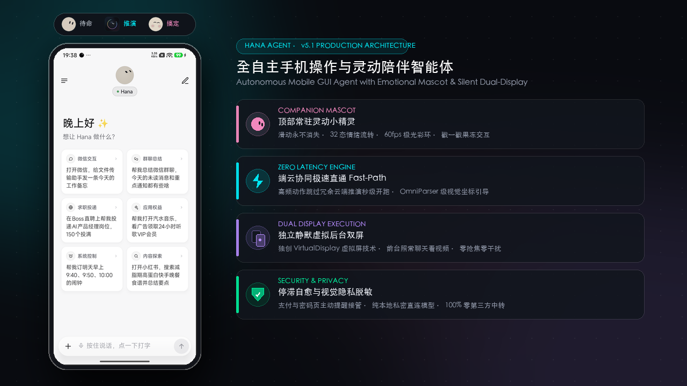

<!-- translated-from: README.md @ 310df315112f -->

# Hana

**Un asistente de IA en tu móvil: dile lo que necesitas y usará tus apps y la web hasta dejarlo hecho.**

Trabaja en una pantalla en segundo plano que no ves, así que puedes seguir usando el móvil con normalidad.

[English](../../README.md) · [简体中文](README.zh-CN.md) · [繁體中文](README.zh-Hant.md) · [日本語](README.ja.md) · [한국어](README.ko.md) · Español

Esta versión en español es una traducción del original en chino simplificado. Si ves algo que suena raro o que no coincide con el original, te agradecemos que lo corrijas con un PR.

 

Con la frase «Envía un mensaje a Transferencia de archivos»: a la izquierda, la conversación con Hana; a la derecha, cada paso en su pantalla en segundo plano (a velocidad 4×, con la lista de chats difuminada)

## Una frase, una tarea resuelta

En varias demos aparecen WeChat, una app de mensajería, y Xiaohongshu (RED), una red social de estilo de vida. Hana no depende de ellas: funciona con cualquier app o sitio web de tu móvil.

## Por qué Hana

| | |
|---|---|
| 📱 **No te quita la pantalla** | Abre apps, toca, escribe y se desplaza en una pantalla aparte en segundo plano mientras tú usas el móvil como siempre; si quieres mirar, toca la vista en miniatura |
| 🧩 **Funciona con cualquier app** | Mira la pantalla y encuentra los botones como lo haría una persona: no necesita APIs de la app ni integraciones previas |
| 🌐 **Llámalo desde cualquier página web** | En el navegador integrado, di lo que quieres en la página que estás leyendo y trabajará ahí mismo; si tocas la página, se detiene |
| 🧠 **Mejora con el uso** | Recuerda las preferencias que le cuentas y convierte las tareas que completa en habilidades, para hacerlas más rápido y con más fiabilidad la próxima vez |
| 🔒 **Tus datos se quedan en tu móvil** | No hay ningún servidor de Hana; usa tu propia clave de API del modelo o inicia sesión con una cuenta de ChatGPT, xAI u OpenRouter |
| 🆓 **Código abierto y gratis** | Apache-2.0, todo el código es público |

## Empieza en tres pasos

1. **Instálalo**: descarga el APK desde [Releases](https://github.com/mengqingshi922-ctrl/hana/releases/latest).
2. **Conecta un modelo**: en Ajustes › Modelo, elige un proveedor e introduce una clave de API, o simplemente inicia sesión con una cuenta ([modelos e inicio de sesión](../models.en.md)).
3. **Para que maneje apps del móvil**: sigue el asistente «Set up phone control» de los ajustes y empareja la depuración inalámbrica una sola vez ([guía de configuración](../setup-guide.en.md)). Si solo quieres chatear, navegar y trabajar con archivos, puedes saltarte este paso.

Después, prueba a decirle: «Pon alarmas mañana a las 9:40 y a las 10:00» o «Mira el tiempo cada mañana a las 8 y avísame solo si va a llover».

> 💡 ¿Tienes un ordenador a mano? Envía esta frase al agente de IA de tu ordenador y lo instalará todo por ti: 
> `Sigue los pasos de https://github.com/mengqingshi922-ctrl/hana/blob/main/docs/install-with-agent.en.md para instalar Hana en el móvil Android conectado por USB.`

## Qué puede hacer

| | |
|---|---|
| **Manejar apps** | Lee listas largas e historiales de chat, toca y escribe, comparte texto con las apps; los inicios de sesión, códigos de verificación y pagos te los deja a ti |
| **Navegar por la web** | Un navegador integrado de tipo escritorio que mantiene tus sesiones, lee páginas, descarga y sube archivos; marca su propio ritmo al pasar páginas y, si algo lo bloquea, te lo pasa |
| **Lo que tienes en pantalla** | Toca dos veces la cápsula flotante para enviarle la pantalla que estás viendo: «¿qué le respondo?», «apúntame esto» |
| **Horarios y condiciones** | «Recuérdamelo mañana a las 9», «haz esto todos los viernes»; se ejecuta a su hora en la conversación original |
| **Interrúmpelo o páralo cuando quieras** | Sigue hablándole mientras trabaja para añadir o corregir cosas (mantén pulsado un mensaje que aún no haya recogido para retirarlo o editarlo); al parar te dice hasta dónde llegó, y con «sigue» retoma desde ahí |
| **Mantén pulsado para hablar** | Mantén pulsado el cuadro de texto para dictar y corrige antes de enviar; mantén pulsada la cápsula flotante para hablar y suelta para enviarlo directamente. Usa el reconocimiento de voz del teléfono o, si no tiene, un modelo de voz de tu proveedor |
| **Archivos y cálculo** | Un sandbox de Linux por conversación ejecuta Python, Node y shell sobre los archivos que le envías (arm64) |
| **Desde tu ordenador** | Las herramientas de IA de tu ordenador pueden encargarle tareas a Hana mediante CLI + Skill o MCP ([usar Hana desde un ordenador](../computer.en.md)) |

Por defecto, Hana funciona en **modo Preguntar**: solo te consulta antes de gastar dinero (hacer pedidos, pagar) y todo lo demás lo hace sin más. También puedes cambiar al **modo Autónomo**. Consulta [Preguntar y Autónomo](../modes.en.md).

Para ver cómo funciona cada cosa y los detalles, consulta las [funciones en detalle](../features.en.md).

## En qué móviles funciona

| | Requisito |
|---|---|
| Chat, web, archivos | Android 11 o posterior |
| Manejar apps del móvil | Android 12 o posterior; **se recomienda Android 14+** (la pantalla en segundo plano tiene su propio foco, así que no interfiere cuando escribes en la pantalla principal) |
| Sandbox de Linux | Dispositivos arm64 |

¿No sabes si tu móvil sirve? Ejecuta Ajustes › Recuperación y reparación › **Autocomprobación de compatibilidad**: 12 comprobaciones en un minuto, y puedes [enviarnos el resultado](https://github.com/mengqingshi922-ctrl/hana/issues/new?template=device-report.yml) con un toque.

## Privacidad y seguridad

- **No hay ningún servidor de Hana**: lo que dices y lo que hay en tu pantalla solo se envía al proveedor de modelos que tú configuras.
- Las claves de API y los recuerdos se guardan cifrados en el móvil; las conversaciones y los registros de ejecución se quedan en el dispositivo; para buscar actualizaciones solo se contacta con GitHub.
- Manejar automáticamente apps y sitios web de terceros puede ir en contra de sus condiciones de uso, así que decide tú. Para lo importante, usa el modo Preguntar y revisa los resultados. Consulta el [aviso legal](../disclaimer.en.md).

## Comunidad y contribuciones

- **Documentación**: toda la documentación y un orden de lectura sugerido están en el [índice de documentación](../README.en.md)
- **Comunidad**: únete al [chat de grupo en X](https://x.com/i/chat/group_join/g2116926829198246025/48B52j5svL); para escribir al autor por WeChat, escanea el código QR de la app en Acerca de Hana › Contactar con el autor (menciona «Hana» en la solicitud)
- **Informa de un problema**: [abre un issue](https://github.com/mengqingshi922-ctrl/hana/issues/new/choose); en la app, Acerca de Hana › Enviar comentarios permite adjuntar información de diagnóstico
- **Contribuye**: añade conocimiento de uso para una app o un sitio web (texto plano, sin programar) o contribuye con código; consulta la [guía de contribución](../../.github/CONTRIBUTING.md)

## Agradecimientos

Hana se inspira en el proyecto de código abierto [Mika](https://github.com/hana/agent/Mika), creado originalmente por hana-team. Agradecemos sinceramente el trabajo pionero de Mika y de la comunidad de código abierto en el campo de los agentes para teléfonos móviles. Hana construye sobre estas bases e introduce innovaciones significativas, como el sistema interactivo de mascota compañera, rutas directas de intención de latencia cero y ejecución híbrida con modelos locales SLM.

## Licencia

[Apache-2.0](../../LICENSE) · [NOTICE](../../NOTICE) · [Componentes de terceros](../../licenses/THIRD_PARTY_NOTICES.md)

