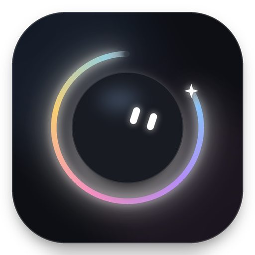
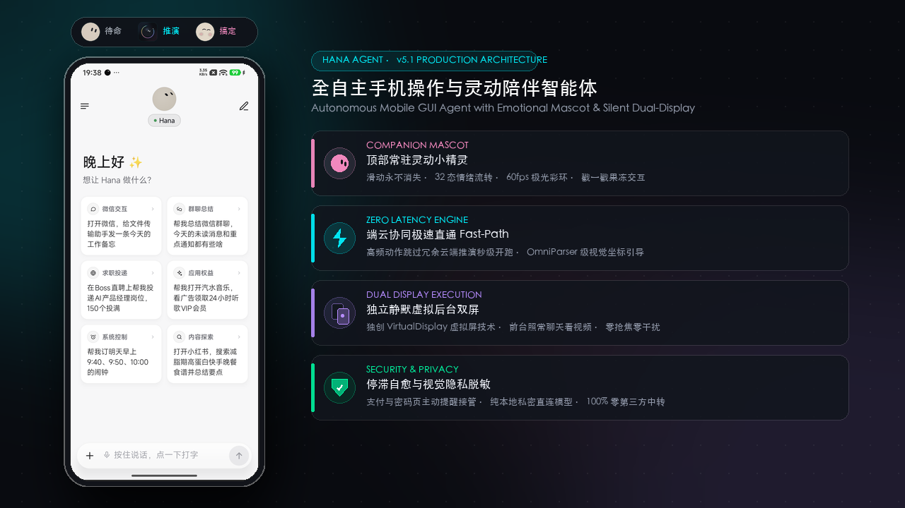

<!-- translated-from: README.md @ 55937e9d15fd -->

# Hana

**スマホの中の AI アシスタント。ひと言伝えれば、アプリやウェブを操作して用事を片づけてくれます。**

作業は見えないバックグラウンド画面で進むので、その間もスマホはいつもどおり使えます。

[English](../../README.md) · [简体中文](README.zh-CN.md) · [繁體中文](README.zh-Hant.md) · 日本語 · [한국어](README.ko.md) · [Español](README.es.md)

この日本語版は中国語（簡体字）版からの翻訳です。不自然な表現や原文とのずれに気づいたら、ぜひ PR で直してください。

 

「ファイル転送アシスタントにメッセージを送って」のひと言で：左は Hana とのチャット、右はバックグラウンド画面での一つひとつの操作（4 倍速、チャット一覧はぼかし処理済み）

## ひと言で、用事がひとつ片づく

デモに出てくる WeChat はメッセージアプリ、小紅書（RED）はライフスタイル系の SNS です。Hana は特定のアプリ専用ではなく、スマホに入っているどのアプリやサイトでも使えます。

## Hana を選ぶ理由

| | |
|---|---|
| 📱 **画面を取られない** | 別のバックグラウンド画面でアプリを開き、タップ、入力、スクロールをこなします。その間もスマホは普段どおり。様子を見たいときは小さなプレビューをタップ |
| 🧩 **どのアプリでも使える** | 人と同じように画面を見てボタンを探すので、アプリ側の API も事前の対応作業もいりません |
| 🌐 **ウェブページからそのまま頼める** | 内蔵ブラウザで見ているページに向かってひと言いえば、そのページ上で作業します。ページに触れればすぐ止まります |
| 🧠 **使うほど賢くなる** | 伝えた好みを覚え、うまくいった作業は自動でスキルにまとめて、次からはより速く確実に |
| 🔒 **データはスマホの中だけ** | Hana のサーバーはありません。自分のモデル API キーを使うか、ChatGPT・xAI・OpenRouter のアカウントでログイン |
| 🆓 **オープンソースで無料** | Apache-2.0、コードはすべて公開 |

## 3 ステップで始める

1. **インストール**：[Releases](https://github.com/mengqingshi922-ctrl/hana/releases/latest) から APK をダウンロード。
2. **モデルをつなぐ**：設定 › モデル でプロバイダーを選んで API キーを入力するか、アカウントでログイン（[モデルとログイン](../models.en.md)）。
3. **スマホのアプリを操作させたいとき**：設定の「Set up phone control」ウィザードに沿って、ワイヤレスデバッグを一度だけペアリング（[セットアップガイド](../setup-guide.en.md)）。チャット、ウェブ、ファイル処理だけならこの手順は不要です。

あとは話しかけるだけ：「明日の朝 9:40 と 10:00 にアラームをセットして」「毎朝 8 時に天気を見て、雨のときだけ教えて」。

> 💡 パソコンが手元にあるなら、この一文をパソコンの AI エージェントに送れば、代わりにセットアップしてくれます： 
> `https://github.com/mengqingshi922-ctrl/hana/blob/main/docs/install-with-agent.en.md の手順に従って、USB で接続している Android スマホに Hana をインストールしてください。`

## できること

| | |
|---|---|
| **アプリを操作** | 長いリストやチャット履歴を読む、タップや入力、アプリへのテキスト共有。ログイン、認証コード、支払いはあなたに任せます |
| **ウェブを使う** | ログイン状態を保つ PC 版の内蔵ブラウザで、ページを読み、ダウンロードやアップロードも。ページ送りはペースを守り、ブロックされたらあなたに渡します |
| **いま見ている画面** | フローティングカプセルをダブルタップすると、見ている画面を Hana に送れます：「これなんて返せばいい？」「メモしておいて」 |
| **時間と条件** | 「明日の朝 9 時にリマインドして」「毎週金曜にこれをやって」。時間になると元の会話の中で実行します |
| **いつでも口をはさめる、止められる** | 作業中でも話しかけて要望を足せます。まだ取り込まれていないものは長押しで取り消しや編集も可能。止めたときはどこまで進んだかを伝え、「続けて」でそこから再開します |
| **押して話す** | 入力欄を押したまま話すと文字が入り、直してから送れます。フローティングカプセルは長押しで話し、指を離すとそのまま送信。端末の音声認識を使い、ない場合はプロバイダーの音声モデルを選べます |
| **ファイルと計算** | 会話ごとに Linux サンドボックスがあり、Python、Node、シェルで送ったファイルを処理します（arm64） |
| **パソコンからも使える** | パソコンの AI ツールから CLI + Skill または MCP で Hana に作業を頼めます（[パソコンから Hana を使う](../computer.en.md)） |

初期設定は**確認モード**です。お金がかかること（注文、支払い）だけは先に確認し、それ以外は最後までこなします。**自律モード**に切り替えることもできます。詳しくは[確認モードと自律モード](../modes.en.md)へ。

それぞれの使い方や細かい点は[機能の詳細](../features.en.md)をご覧ください。

## 対応スマホ

| | 必要な環境 |
|---|---|
| チャット、ウェブ、ファイル | Android 11 以降 |
| スマホのアプリ操作 | Android 12 以降。**Android 14 以降を推奨**（バックグラウンド画面が独自のフォーカスを持つので、メイン画面での入力を邪魔しません） |
| Linux サンドボックス | arm64 端末 |

自分のスマホで動くか不安なら、設定 › 復旧と修復 › **互換性セルフチェック** を実行してください。1 分ほどで 12 項目を確認でき、結果はワンタップで[私たちに送れます](https://github.com/mengqingshi922-ctrl/hana/issues/new?template=device-report.yml)。

## プライバシーと安全

- **Hana のサーバーはありません**：話した内容や画面の内容は、あなたが設定したモデルプロバイダーにだけ送られます。
- API キーと記憶は暗号化してスマホに保存。会話と実行記録は端末内だけに残り、アップデートの確認で接続するのは GitHub だけです。
- 他社のアプリやサイトを自動で操作すると、その利用規約に反する場合があります。ご自身で判断してください。大事な用事は確認モードで行い、結果を確かめてください。詳しくは[免責事項](../disclaimer.en.md)へ。

## コミュニティと貢献

- **ドキュメント**：すべてのドキュメントとおすすめの読む順番は[ドキュメント一覧](../README.en.md)へ
- **コミュニティ**：[X のグループチャット](https://x.com/i/chat/group_join/g2116926829198246025/48B52j5svL)に参加できます。WeChat で作者に連絡するには、アプリの 「Hana について › 作者に連絡」 にある QR コードを読み取ってください（友達申請に「Hana」と書いてください）
- **問題を報告**：[Issue を作成](https://github.com/mengqingshi922-ctrl/hana/issues/new/choose)。アプリの 「Hana について › フィードバックを送信」 から診断情報を添えられます
- **貢献する**：アプリやサイトの使い方の知識を書き足す（プレーンテキストで、コードは不要）、またはコードで貢献。[コントリビューションガイド](../../.github/CONTRIBUTING.md)をご覧ください

## 謝辞

Hana は、オープンソースプロジェクト [Mika](https://github.com/hana/agent/Mika) にインスパイアされて誕生しました。スマートフォン自律操作エージェントの領域において先駆的な貢献を果たされた Mika とオープンソースコミュニティに心より敬意と感謝を表します。Hana はこの基盤の上に立ち、コンパニオンマスコットシステム、ゼロレイテンシーのインテント直通、オンデバイス SLM ハイブリッド実行など、広範な革新を行っています。

## ライセンス

[Apache-2.0](../../LICENSE) · [NOTICE](../../NOTICE) · [サードパーティコンポーネント](../../licenses/THIRD_PARTY_NOTICES.md)
