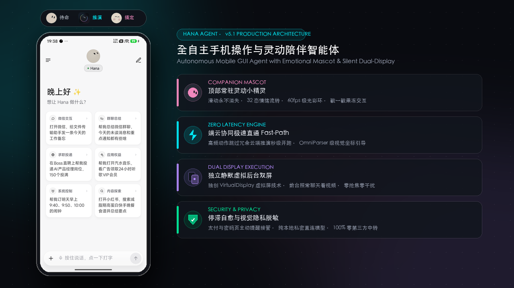

<!-- translated-from: README.md @ 310df315112f -->

# 🌸 Hana

### 灵动陪伴型全自主手机操作智能体
**Autonomous Mobile GUI Agent with Emotional Mascot & Silent Dual-Display Execution**

  <b>说一句话，它替你自动规划、精准感知、操控 App 与浏览网页，把复杂繁琐的多步操作变成一次交付。</b> 
  独创静默后台虚拟双屏技术与灵动小精灵交互体系 —— 它在后台替你忙碌，你照常前台刷手机，互不干扰、零抢焦。

[English](../../README.md) · **简体中文** · [繁體中文](README.zh-Hant.md) · [日本語](README.ja.md) · [한국어](README.ko.md) · [Español](README.es.md)

 

✨ 置顶常驻灵动小精灵（32态情绪流转）· 毫秒级端云极速直通 Fast-Path · 静默独立虚拟双屏 · 视觉隐私脱敏与停滞自愈

## 一句话，全自动搞定复杂任务

用户只需下达自然语言指令，Hana 即可通过端侧感知、意图快速判断与无障碍/虚拟屏注入完成跨应用操作：

- 📱 **社交生活自动化**：「打开微信，给文件传输助手发一条今天的工作备忘」「在小红书搜一下最新的露营攻略，点赞最热门的前三篇笔记」
- 🛒 **电商比价与加购**：「在电商平台搜 30 元以内的快充充电器，按销量排序加购物车，停在付款前」
- 🔍 **信息速览与提炼**：「翻一下群里今天聊了什么，提炼出关键待办事项发给我」
- ⏰ **系统与日程调度**：「帮我订明天早上 8:30 和 9:00 的闹钟，并查看明天是否下雨」

## 为什么选择 Hana

| 核心特性 | 深度说明 |
|---|---|
| 🤖 **灵动陪伴小精灵（Mascot）** | 顶部永久常驻灵动小精灵与紧凑状态胶囊，上下滑动列表永不消失；支持 60fps 旋转霓虹彩环、好奇探视、眨眼欢跳等全状态情绪感知，支持戳一戳果冻微动效与 4 款几何造型随心切换 |
| ⚡ **端云协同极速直通** | 告别开局傻等！内置意图直通（IntentGate Fast-Path）与 OmniParser 级坐标引导，高频动作跳过远程冗余推理秒级开跑，复合操作工具链实现零时延连招 |
| 📱 **隐形独立后台屏** | 在独立的虚拟后台屏幕上开 App、点击、输入、滚动，完全不侵占手机当前前台；你在前台聊天刷视频，它在后台替你自动完成多步复杂任务 |
| 🛡️ **智能消错与视觉脱敏** | 引入停滞自愈逃生机制与动态重试；自动拦截密码、支付等隐私界面提醒接管，画面上报前自动进行视觉隐私脱敏 |
| 🧩 **无缝掌控任意 App** | 基于屏幕视觉理解与无障碍无侵入交互，无需第三方 App 开放 API 或专门适配，像真人一样感知与操作手机 |
| 🧠 **端侧轻量小模型 (Local SLM)** | 支持本地端侧模型（如 Qwen、UI-TARS）与云端多模态大模型混合协同，同应用内微动作端侧本地爆发，省流更极速 |
| 🔒 **本地私密，数据不落第三方** | 无中间服务器，Prompt、会话记录与视觉截屏直接与你自己配置的模型服务商端对端通信，完全掌握自己的数据资产 |
| 🆓 **开源、免费** | 采用 Apache-2.0 许可证，代码与设计架构全面开放 |

## 三步开始

1. **下载安装**：从 [Releases](https://github.com/mengqingshi922-ctrl/hana/releases/latest) 下载 APK。
2. **连上模型**：设置 › 模型，选一家服务商填 API Key，或者直接用账号登录（[模型与登录](../models.md)）。
3. **要操作手机 App 时**：按设置里「设置手机操作」的向导，在手机上配对一次无线调试（[设置指南](../setup-guide.md)）。只聊天、上网、处理文件可以跳过这一步。

然后说一句试试：「帮我订明天早上 9:40 和 10:00 的闹钟」「每天早上 8 点看看天气，下雨才告诉我」。

> 💡 手边有电脑？把这句话发给电脑上的 AI 助手，它会帮你装好： 
> `请按 https://github.com/mengqingshi922-ctrl/hana/blob/main/docs/install-with-agent.md 的步骤，帮我把 Hana 安装到通过 USB 连着的安卓手机上。`

## 能做什么

| | |
|---|---|
| **操作 App** | 读长列表和聊天记录、点击输入、分享文字进 App；登录、验证码、付款请你接管 |
| **上网** | 内置电脑版浏览器，登录状态保留，能读页面、下载上传；翻页有节奏，遇到拦截交给你 |
| **此刻的屏幕** | 双击悬浮胶囊，把你正在看的这一屏发给 Hana：「这个怎么回」「帮我记下来」 |
| **定时与条件** | 「明早 9 点提醒我」「每周五做某件事」，到点在原对话里执行 |
| **随时插话、随时停** | 任务进行中继续说话补充要求，还没处理的可以长按撤回或修改；停下后交代做到哪了，说「继续」接着做 |
| **按住说话** | 输入框按住说话，字填进框里改了再发；悬浮胶囊长按说话，松开直接发出。用手机自带的语音识别，没有时可选服务商的语音模型 |
| **文件与计算** | 每个对话一个 Linux 沙箱，跑 Python、Node 和 shell，处理你发来的文件（arm64） |
| **电脑上也能用** | 电脑上的 AI 工具通过 CLI + Skill 或 MCP 给 Hana 派任务（[从电脑使用 Hana](../computer.md)） |

默认是**询问模式**：只有花钱（下单、付款）先问你，其他事直接做完；也可以换成**自主模式**。详见[询问与自主](../modes.md)。

每一项怎么用、有哪些细节，见[详细说明](../features.md)。

已经写了使用知识的 App 和网站（没写到的照样能用）

<!-- generated:knowledge:start -->
<!-- 这一段由 ./gradlew updateReadme 生成，不要手改 -->
| 类别 | 内置 |
|---|---|
| **App** | Android 设置、百家号、哔哩哔哩、BOSS直聘、Chrome、得到、抖音、飞书、Gmail、即刻、快手、领英、QQ邮箱、Telegram、今日头条、Uber、Uber Eats、微信、微博、WhatsApp、闲鱼、小红书、知乎 |
| **网站** | Amazon、哔哩哔哩、Google Calendar、豆瓣、抖音、Instagram、Gmail、Google Maps、Telegram、百度贴吧、微博、搜狗微信、WhatsApp、小红书、小宇宙、YouTube、知乎、BOSS直聘 |
| **通用做法**（技能） | 改 Hana 自己的设置、把内容整理成文字、处理 PDF 文档、查清一件事、消息与邮件、写技能 |
<!-- generated:knowledge:end -->

支持的模型服务商

<!-- generated:providers:start -->
<!-- 这一段由 ./gradlew updateReadme 生成，不要手改 -->
内置 DeepSeek、Agnes AI (中国站)、Agnes AI (国际站)、AMD (中国站)、通义千问、Kimi、智谱、硅基流动、火山方舟、MiniMax、阶跃星辰、腾讯混元、百度千帆、OpenRouter、OpenCode Go、Anthropic、Gemini、OpenAI、xAI、Mistral、Groq、Ollama、LM Studio、本地端侧模型 (Local SLM) 等服务商预设；其他服务商选「自定义」，OpenAI 兼容、Anthropic、Gemini、OpenAI Responses 接口都能接。
<!-- generated:providers:end -->

也可以不填 Key：ChatGPT（Plus / Pro）、xAI / Grok、OpenRouter 账号登录。添加模型的步骤和各家登录的注意事项见[模型与登录](../models.md)。

## 能在哪些手机上用

| | 要求 |
|---|---|
| 聊天、上网、文件 | 安卓 11 及以上 |
| 操作手机 App | 安卓 12 及以上；**推荐安卓 14+**（后台屏有自己的焦点，不影响你在主屏打字） |
| Linux 沙箱 | arm64 设备 |

不确定自己的手机行不行？设置 › 恢复与修复 › **兼容性自检**，一分钟跑完 12 项，结果可以一键[反馈给我们](https://github.com/mengqingshi922-ctrl/hana/issues/new?template=device-report.yml)。

## 隐私与安全

- **没有 Hana 服务器**：你的话、屏幕内容只发给你自己配置的模型服务商。
- API Key、记忆加密保存在手机上；对话、运行记录只存在本机；检查更新只访问 GitHub。
- 自动操作第三方 App 和网站可能违反它们的用户协议，请自行判断。重要的事用询问模式，并检查结果。详见[免责声明](../disclaimer.md)。

<b>常见问题</b>

**无线调试自己关掉了？** 安卓在换 Wi-Fi、重启后会关掉它。Hana 会在你允许的前提下自己打开；连不上就回到「设置手机操作」重新配对。

**系统里找不到无线调试？** 有的手机系统去掉了这一项，可以用电脑经 USB 启动手机助手，见[设置指南](../setup-guide.md)。

**有的页面读不到、截不到？** 付款、输密码这类页面禁止截屏，Hana 会请你接管。

**能用自己电脑上跑的模型吗？** 可以，服务商选「自定义」，填局域网地址即可。

**更新从哪来？** 只从本仓库的 [Releases](https://github.com/mengqingshi922-ctrl/hana/releases) 发布；App 里「关于 › 检查更新」也能直接升级。

更多问答见[常见问题](../faq.md)。

## 社区与贡献

- **文档**：全部文档和阅读顺序见[文档目录](../README.md)
- **交流**：欢迎在 [GitHub Discussions](https://github.com/mengqingshi922-ctrl/hana/discussions) 交流使用心得与反馈想法
- **反馈问题**：[提 Issue](https://github.com/mengqingshi922-ctrl/hana/issues/new/choose)，App 里「关于 › 反馈问题」可以附上诊断信息
- **参与贡献**：给某个 App、网站补一份使用知识（纯文本，不用写代码），或者贡献代码，见[贡献指南](../../.github/CONTRIBUTING.zh-CN.md)

## 致敬与鸣谢

Hana 的设计与诞生深受开源项目 [Mika](https://github.com/hana/agent/Mika) 的启发。衷心感谢原作者与开源社区在手机操作智能体（Phone-Operating Agent）领域的技术探索与先驱贡献。Hana 在此灵感基础上进行了深度自主重构与体系化创新——引入了陪伴型灵动小精灵交互体系、端云协同意图直通加速、端侧本地轻量模型（Local SLM）混合调度以及全自主社交复合操作流。

## 许可证

[Apache-2.0](../../LICENSE) · [NOTICE](../../NOTICE) · [第三方组件](../../licenses/THIRD_PARTY_NOTICES.md)
