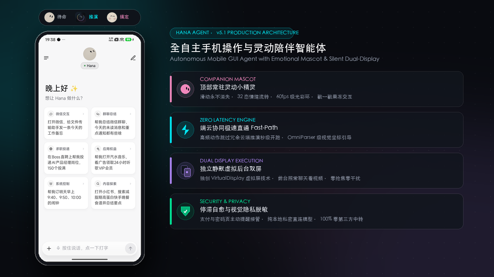

<!-- translated-from: README.md @ 310df315112f -->

# Hana

**你手機上的 AI 助理：說一句話，它替你操作 App、上網，把事情辦好。**

它在一塊看不見的背景螢幕上做事，你照樣滑你的手機。

[English](../../README.md) · [简体中文](README.zh-CN.md) · 繁體中文 · [日本語](README.ja.md) · [한국어](README.ko.md) · [Español](README.es.md)

這份繁體中文版譯自簡體中文版。用詞不夠道地、或內容跟原文對不上的地方，歡迎直接發 PR 修改。

 

一句話「給文件傳輸助手發一則訊息」：左邊是 Hana 的對話，右邊是它在背景螢幕上的每一步（4 倍速播放，聊天列表已打碼）

## 一句話，辦好一件事

## 為什麼選 Hana

| | |
|---|---|
| 📱 **不佔用你的螢幕** | 在一塊獨立的背景螢幕上打開 App、點按、打字、翻頁，你照常用手機；想看就點開小畫面 |
| 🧩 **什麼 App 都能用** | 像人一樣看畫面、找按鈕，不需要 App 開放介面，也不用事先適配 |
| 🌐 **在網頁上直接叫它** | 在內建瀏覽器裡，對著正在看的這一頁說一句，它就在這一頁上做事；你一碰頁面它就停 |
| 🧠 **越用越上手** | 記得你說過的偏好；辦成的事會自動整理成技能，下次更快更穩 |
| 🔒 **資料只留在你手機上** | 沒有 Hana 伺服器；用你自己的模型 Key，或用 ChatGPT、xAI、OpenRouter 帳號登入 |
| 🆓 **開源、免費** | Apache-2.0，程式碼全部公開 |

## 三步開始

1. **下載安裝**：從 [Releases](https://github.com/mengqingshi922-ctrl/hana/releases/latest) 下載 APK。
2. **連上模型**：設定 › 模型，選一家服務商填入 API Key，或直接用帳號登入（[模型與登入](../models.md)）。
3. **要操作手機 App 時**：照著設定裡「設定手機操作」的引導，在手機上配對一次無線偵錯（[設定指南](../setup-guide.md)）。只聊天、上網、處理檔案的話可以跳過這一步。

然後說一句試試：「幫我設明天早上 9:40 和 10:00 的鬧鐘」「每天早上 8 點看看天氣，會下雨才告訴我」。

> 💡 手邊有電腦？把這句話傳給電腦上的 AI 助手，它會幫你裝好： 
> `請依照 https://github.com/mengqingshi922-ctrl/hana/blob/main/docs/install-with-agent.md 的步驟，幫我把 Hana 安裝到透過 USB 連著的 Android 手機上。`

## 能做什麼

| | |
|---|---|
| **操作 App** | 讀長列表和聊天紀錄、點按輸入、分享文字到 App；登入、驗證碼、付款交給你接手 |
| **上網** | 內建電腦版瀏覽器，保留登入狀態，能讀頁面、下載上傳；翻頁有節奏，遇到攔截交給你 |
| **此刻的螢幕** | 點兩下懸浮膠囊，把你正在看的這個畫面傳給 Hana：「這要怎麼回」「幫我記下來」 |
| **定時與條件** | 「明早 9 點提醒我」「每週五做某件事」，時間到了在原本的對話裡執行 |
| **隨時插話、隨時停** | 任務進行中可以繼續補充要求，還沒處理的可以長按撤回或修改；停下後會交代做到哪裡，說「繼續」就接著做 |
| **按住說話** | 輸入框按住說話，字填進框裡改好再送出；懸浮膠囊長按說話，放開直接送出。用手機內建的語音辨識，沒有時可選服務商的語音模型 |
| **檔案與運算** | 每個對話一個 Linux 沙箱，跑 Python、Node 和 shell，處理你傳來的檔案（arm64） |
| **電腦上也能用** | 電腦上的 AI 工具透過 CLI + Skill 或 MCP 把任務交給 Hana（[從電腦使用 Hana](../computer.md)） |

預設是**詢問模式**：只有花錢（下單、付款）會先問你，其他事直接做完；也可以改成**自主模式**。詳見[詢問與自主](../modes.md)。

每一項怎麼用、有哪些細節，見[詳細說明](../features.md)。

## 能在哪些手機上用

| | 需求 |
|---|---|
| 聊天、上網、檔案 | Android 11 以上 |
| 操作手機 App | Android 12 以上；**建議 Android 14+**（背景螢幕有自己的焦點，不影響你在主螢幕打字） |
| Linux 沙箱 | arm64 裝置 |

不確定自己的手機行不行？設定 › 恢復與修復 › **相容性自我檢查**，一分鐘跑完 12 項，結果可以一鍵[回報給我們](https://github.com/mengqingshi922-ctrl/hana/issues/new?template=device-report.yml)。

## 隱私與安全

- **沒有 Hana 伺服器**：你說的話、螢幕內容只會傳給你自己設定的模型服務商。
- API Key、記憶加密保存在手機上；對話、執行紀錄只存在本機；檢查更新只連到 GitHub。
- 自動操作第三方 App 和網站可能違反它們的使用條款，請自行判斷。重要的事用詢問模式，並檢查結果。詳見[免責聲明](../disclaimer.md)。

## 社群與貢獻

- **文件**：全部文件和閱讀順序見[文件目錄](../README.md)
- **交流**：App 裡「關於 › 聯絡作者」掃碼加作者微信（請備註 Hana）；不用微信的話可以加入 [X 群聊](https://x.com/i/chat/group_join/g2116926829198246025/48B52j5svL)
- **回報問題**：[開 Issue](https://github.com/mengqingshi922-ctrl/hana/issues/new/choose)，App 裡「關於 › 回報問題」可以附上診斷資訊
- **參與貢獻**：為某個 App、網站補一份使用知識（純文字，不用寫程式），或者貢獻程式碼，見[貢獻指南](../../.github/CONTRIBUTING.zh-CN.md)

## 致敬與鳴謝

Hana 的靈感來自開源專案 [Mika](https://github.com/hana/agent/Mika)，由 hana-team 最初建立。我們衷心感謝 Mika 及開源社群在手機 Agent 領域做出的開創性探索。Hana 在此基礎上進行了廣泛創新——引入了互動式桌寵伴侶系統、零延遲意圖直通、端側 SLM 混合執行以及強大的動作鏈結能力。

## 許可證

[Apache-2.0](../../LICENSE) · [NOTICE](../../NOTICE) · [第三方組件](../../licenses/THIRD_PARTY_NOTICES.md)

